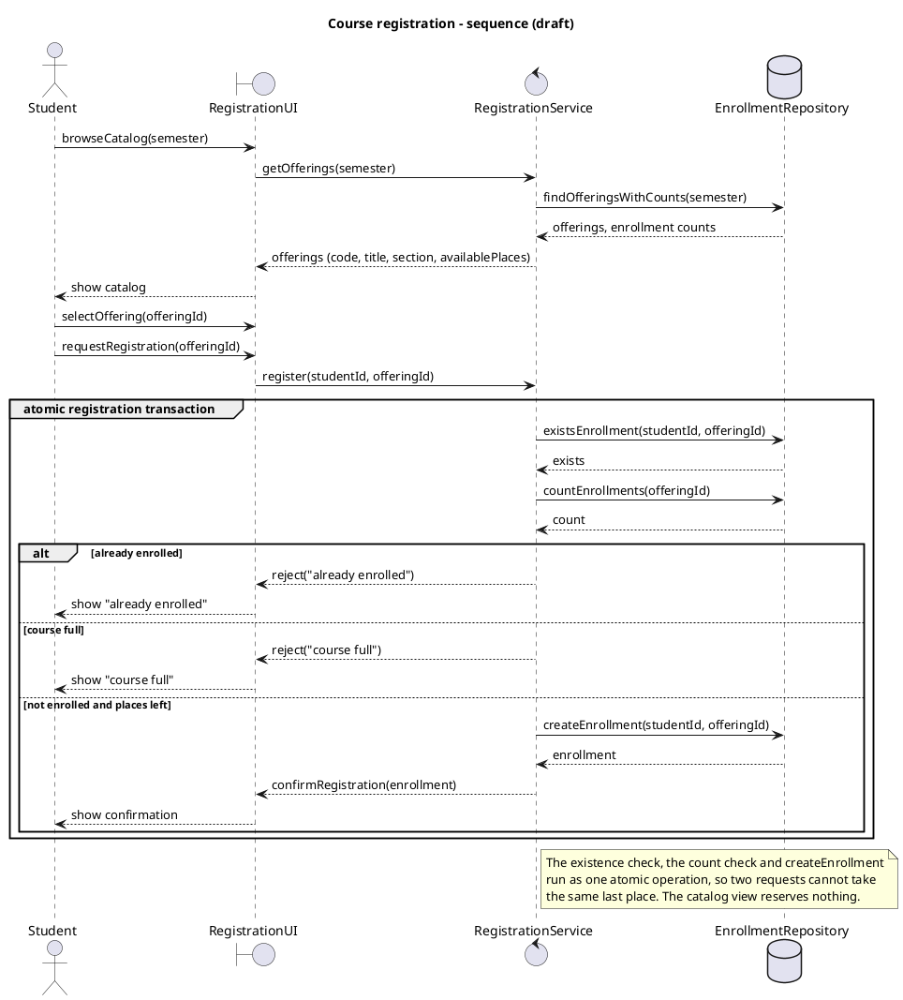
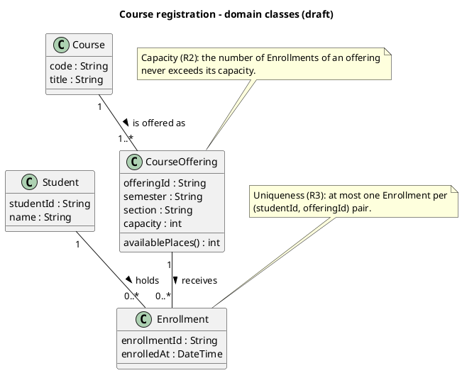
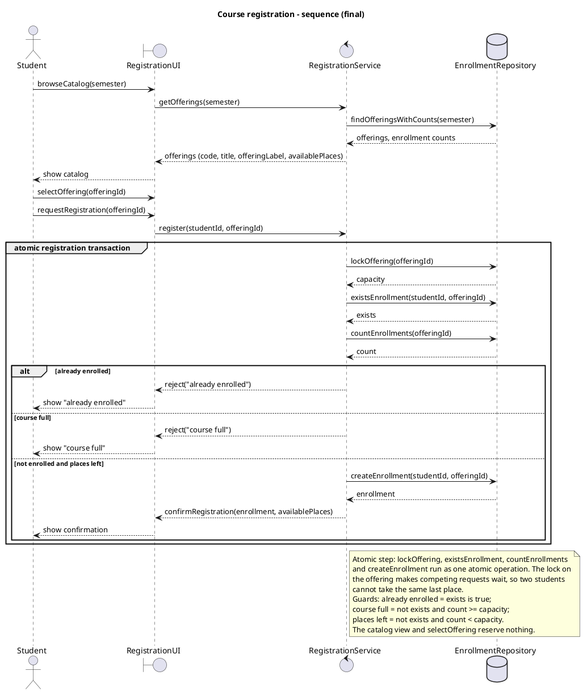
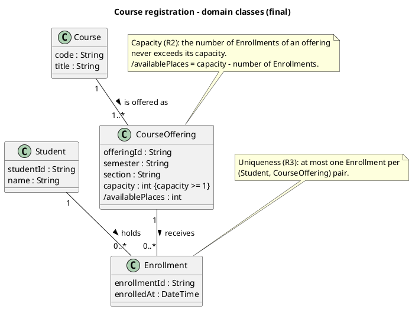
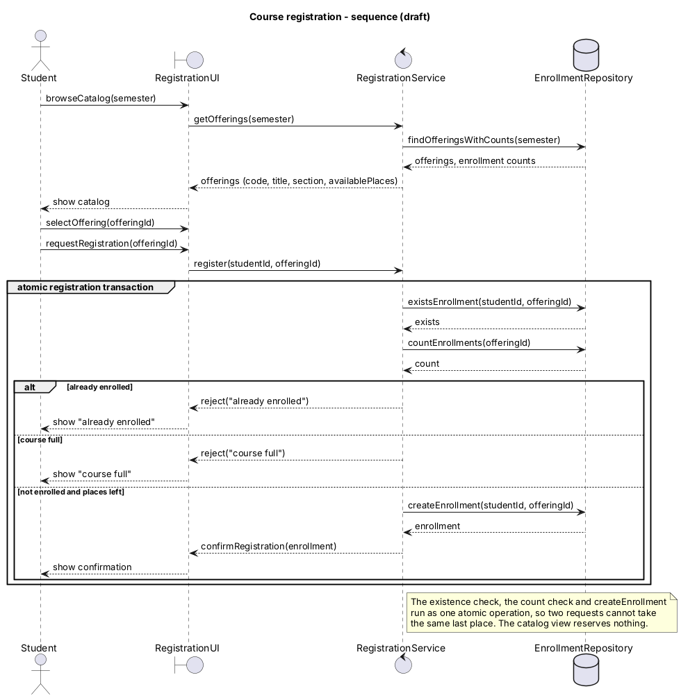
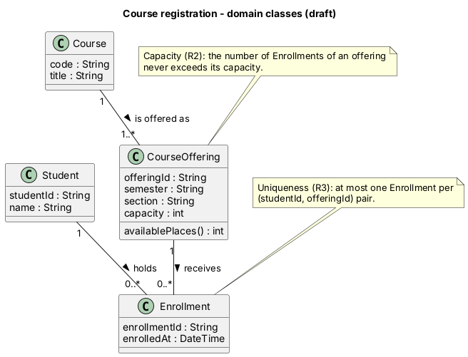

# SIS #02 — AI-Assisted UML Modeling: University Course Registration

<!--
  This is the only file you write your report in. README.md tells you what goes where.

  Rules the checker relies on:
  - Do not delete, rename or renumber the ## headings, the ### headings, or the **Label:** words.
  - Replace every "(write here)" and "(paste here)". None may be left when you submit.
  - Comments like this one are ignored by the checker and the word counter. Delete them or leave them.
-->

## 1. Scope and assumptions

<!-- Your FINAL scope statement and assumptions, after reviewing Prompt A's output. Say here
     what is out of scope (payments, prerequisites, timetable clashes, waiting lists,
     cancellation) — section 2 must not mention them. Section 10 keeps your first version. -->

**Scope:** a signed-in student browses the catalog of one semester and registers for one specific course offering; the duplicate and capacity checks and the creation of the Enrollment happen as one atomic step. Out of scope: payments, prerequisites, timetable clashes, waiting lists and cancellation.

**Assumptions:**

1. The enrollment count of an offering is the number of Enrollment records for that offering; available places = capacity minus that count, so nothing else has to be updated.
2. Two registration requests that arrive at the same time are handled one at a time inside the atomic step, so they cannot both take the last place.
3. If a request is both a duplicate and for a full offering, "already enrolled" is reported (the duplicate check comes first).
4. A catalog view and the selection of an offering reserve nothing.

## 2. User stories and acceptance criteria

<!-- Your APPROVED requirements: Prompt A's draft after your review. Keep the IDs, the three
     story headings and the bullet shape. Every criterion names the rule(s) it maps to,
     e.g. (R2, R4). Two criteria per story. Nothing out of scope.
     Format of a criterion, on one bullet:
     - **AC-03** (R2, R4): Given ..., When ..., Then ... -->

### US-01 — Browse offerings

**US-01:** As a student, I want to see the offerings of one semester with course code, title, offering and available places, so that I can choose an offering to register for.

- **AC-01** (R1): Given semester Fall 2026 has offering CS101-01 of course CS101 "Introduction to Programming" with capacity 30 and 12 enrollments, When the student opens the catalog for Fall 2026, Then the catalog lists CS101, "Introduction to Programming", CS101-01 and 18 available places.
- **AC-02** (R1, R2): Given the catalog shows 1 available place for CS101-01, When the student only views the catalog, Then no place is reserved and the enrollment count of CS101-01 stays unchanged.

### US-02 — Register for an offering

**US-02:** As a student, I want to register for a specific offering, so that I get a confirmed place in it.

- **AC-03** (R2, R4): Given CS101-01 has capacity 2 and 0 enrollments and the student is not enrolled in it, When the student requests registration for CS101-01, Then exactly one Enrollment linking the student and CS101-01 is created, the available places become 1 and a confirmation is returned.
- **AC-04** (R2, R4): Given CS101-01 has capacity 2 and 1 enrollment and the student is not enrolled in it, When the student requests registration, Then exactly one Enrollment is created, the enrollment count becomes 2, 0 places remain and a confirmation is returned.

### US-03 — Receive a clear rejection

**US-03:** As a student, I want a clear reason when my registration is rejected, so that I understand why I was not enrolled.

- **AC-05** (R2, R5): Given the catalog earlier showed a free place but CS101-01 now has 2 enrollments of capacity 2, When the student requests registration, Then the request is rejected with "course full", no Enrollment is created and the count stays 2.
- **AC-06** (R3, R5): Given the student already has an Enrollment in CS101-01, which has capacity 2 and 1 enrollment, When the same student requests registration again, Then the request is rejected with "already enrolled", no Enrollment is created and the count stays 1.

## 3. Sequence diagram

<!-- The FINAL diagram, rendered. Change .png to .svg if that is what you exported. -->


**Participants:** `Student` (actor, the signed-in student), `RegistrationUI` (boundary, the catalog and registration screen), `RegistrationService` (control, runs the checks and owns the atomic step), `EnrollmentRepository` (database, stored offerings and Enrollments).

**Atomic operation:** the `atomic registration transaction` group: `lockOffering(offeringId)` (returns capacity and makes competing requests wait), `existsEnrollment` (duplicate check, R3), `countEnrollments` (capacity check, R2) and, only in the success branch, `createEnrollment`. A catalog view only reads counts; it reserves nothing, so the count is checked again inside the group after `register`.

**Where the Enrollment is created:** `RegistrationService -> EnrollmentRepository : createEnrollment(studentId, offeringId)` in the branch `else not enrolled and places left`; it produces one `Enrollment` object of section 4, linked to one `Student` and one `CourseOffering`. `confirmRegistration` comes after it.

**Technical lifelines:** `RegistrationUI`, `RegistrationService` and `EnrollmentRepository` are not classes in the domain class diagram. The class diagram shows domain concepts (what exists); the sequence diagram needs design-level objects that show who asks, who decides and where data is stored. They hold no domain data of their own, so leaving them out of the domain model is fine.

## 4. Class diagram

<!-- The FINAL diagram, rendered. -->


<!-- One row per association in classes.puml, read in both directions. -->

| Association | Read left to right | Read right to left |
| --- | --- | --- |
| Course 1 -- 1..* CourseOffering (is offered as) | One Course is offered as one or more CourseOfferings | Each CourseOffering is a section of exactly one Course |
| Student 1 -- 0..* Enrollment (holds) | One Student holds zero or more Enrollments | Each Enrollment is held by exactly one Student |
| CourseOffering 1 -- 0..* Enrollment (receives) | One CourseOffering receives zero or more Enrollments | Each Enrollment belongs to exactly one CourseOffering |

**How an Enrollment links a student to an offering:** Enrollment is the link object between the two: its multiplicity is "1" towards Student and "1" towards CourseOffering, so every Enrollment connects exactly one student to exactly one offering. The student and the offering reach each other only through their Enrollments.

**Capacity constraint:** (note N1, R2) the number of Enrollments of an offering never exceeds its `capacity`; `/availablePlaces = capacity - number of Enrollments`. Multiplicity `0..*` cannot express it, because the upper bound is a different number for every offering and is stored as data, not fixed in the diagram.

**Uniqueness constraint:** (note N2, R3) at most one Enrollment per (Student, CourseOffering) pair. Multiplicity cannot express it: `0..*` on each association is correct on its own (a student has many enrollments, an offering has many), and multiplicity counts links of one association, not combinations of two.

## 5. Traceability

<!-- Every rule, including the catalog fields and availability (R1). Column 1: the rule and
     the criteria that cover it, e.g. "R2 + AC-03, AC-04". Column 2: the message, guard,
     class or constraint that shows the rule in YOUR diagrams. Column 3: the T-ID that
     exercises it, or the extra check you did instead (R1 has no T case). -->

| Rule and criterion | Model evidence | Validation case |
| --- | --- | --- |
| R1 + AC-01, AC-02 | `browseCatalog(semester)`, `getOfferings(semester)` returning code, title, offeringLabel, availablePlaces; Course.code, Course.title, CourseOffering.semester, /availablePlaces | No T case: checked AC-01 by hand - capacity 30, 12 Enrollments gives 18 available places from the N1 formula |
| R2 + AC-02, AC-03, AC-04, AC-05 | `lockOffering` -> capacity, `countEnrollments` inside the atomic group; guard `else course full`; note N1 | T2, T3 |
| R3 + AC-06 | `existsEnrollment(studentId, offeringId)`; guard `alt already enrolled`; note N2 | T4 |
| R4 + AC-03, AC-04 | `createEnrollment(studentId, offeringId)` then `confirmRegistration(enrollment, availablePlaces)`; Enrollment 1-1 links; derived /availablePlaces | T1, T2 |
| R5 + AC-05, AC-06 | `reject("course full")`, `reject("already enrolled")` in the two rejection branches, no create there | T3, T4 |

## 6. Walkthroughs

<!-- Walk each case through YOUR final sequence diagram, message by message. Column 2: the
     actual steps and the state change (count before → after). Column 3 starts with Pass or
     Fail, then the location: the message, guard or note where you saw it. A Fail you
     report honestly is a finding, not a penalty. -->

| Case | Observed path and state change | Judgment and evidence |
| --- | --- | --- |
| T1. Available | register -> lockOffering returns capacity 2 -> existsEnrollment false -> countEnrollments 0 -> guard not enrolled and places left -> createEnrollment -> confirmRegistration. Count goes from 0 to 1, available places from 2 to 1. | Pass - branch `else not enrolled and places left`, message `createEnrollment` followed by `confirmRegistration` |
| T2. Last place | register -> lockOffering capacity 2 -> existsEnrollment false -> countEnrollments 1 -> 1 < 2 so places left -> createEnrollment -> confirmRegistration. Count goes from 1 to 2, available places become 0. | Pass - guard condition in the note (count < capacity) and `createEnrollment`; a competing request waits on `lockOffering` and then sees count 2 |
| T3. Full | Catalog earlier showed a place; register -> lockOffering capacity 2 -> existsEnrollment false -> countEnrollments 2 -> 2 >= 2 so course full -> reject("course full"). No Enrollment created, count stays 2. | Pass - guard `else course full`, message `reject("course full")`; the recheck is `countEnrollments` inside the atomic group, not the catalog |
| T4. Duplicate | register -> lockOffering capacity 2 -> existsEnrollment true -> countEnrollments 1 -> guard already enrolled -> reject("already enrolled"). No Enrollment created, count stays 1. | Pass - guard `alt already enrolled`, message `reject("already enrolled")`, nothing created in that branch |

## 7. Review decisions

<!-- At least three substantive decisions about Prompt C's critique or your own inspection.
     Decision: accepted / rejected / modified — and what you did. Reason: why, in a full
     sentence. Rule: R1–R5. Do not invent an error to fill the table; a justified rejection
     of advice counts. -->

| AI suggestion or model element | Decision | Reason | Rule |
| --- | --- | --- | --- |
| Original sequence: `countEnrollments` returns count but capacity is never read before the `else course full` guard (Prompt C defect 1) | Accepted - added `lockOffering(offeringId)` returning capacity as the first message of the atomic group, guard conditions written in the note | In T3 I could not decide from the original diagram whether 2 enrollments means full, because capacity was missing | R2, R5 |
| Prompt C defect 2: move the reject/confirm replies outside the atomic group into a second alt | Rejected - replies stay inside the alt branches | A second alt would repeat the same three guards, and the note already limits the atomic step to the checks and createEnrollment | R4, R5 |
| Original catalog return `offerings (code, title, section, availablePlaces)` (Prompt C defect 3) | Accepted - renamed to `offeringLabel` (code-section, e.g. CS101-01) | AC-01 expects the student to see CS101-01, and a bare section number is not the offering R1 asks for | R1 |
| Class: `availablePlaces()` operation and uniqueness note on (studentId, offeringId) | Modified - derived `/availablePlaces`, `{capacity >= 1}`, note N2 reworded to (Student, CourseOffering) pair | Enrollment has no studentId attribute, the link is the association, and availability must change automatically when an Enrollment is created | R2, R3, R4 |
| Prompt C optional: add OfferingRepository and change Course 1..* CourseOffering to 0..* | Rejected - kept one repository and 1..* | No rule needs a second repository, and in a one-semester catalog a Course is only shown through its offerings | R1 |

## 8. Modeling explanation

<!-- 200–300 words. Your main design choices; how the class diagram and the sequence diagram
     complement each other; why an activity diagram could also help explain the workflow. -->

The main design choice is that Enrollment is its own class between Student and CourseOffering. Each Enrollment has multiplicity 1 towards both, so one record always links one student to one offering, and the enrollment count is just the number of these records. Because of that, available places are derived (capacity minus the count) and are not stored. Creating an Enrollment therefore updates availability automatically, and a rejected request, which creates nothing, cannot change the count.

The second choice is where the checks happen. The catalog only reads data and reserves nothing. After the student sends register, the service locks the offering, checks for an existing enrollment, counts the enrollments and only then decides. These steps and createEnrollment form one atomic group, so two students who saw the same last place are handled one after another, and the second one gets "course full". The duplicate check comes first, so a student who is already enrolled always sees "already enrolled".

The two diagrams complement each other. The class diagram shows what exists and which rules always hold: the multiplicities, the capacity note and the uniqueness note. The sequence diagram shows when those rules are checked and by whom, with the three guarded branches and the order of messages. The capacity rule appears in both: as a constraint in the class diagram and as the course full guard in the sequence.

An activity diagram could also help, because the registration is really a decision flow: request, lock, duplicate decision, capacity decision, then create or reject. It would show the three outcomes as plain branches without the lifelines, so a non-technical reader could follow it, and it would make the order of the two checks very clear.

## 9. Reflection

<!-- 150–200 words. Written by you, not by the assistant: where AI helped, one decision you
     made yourself, one remaining limitation. Specific beats flattering. -->

The AI helped most with speed. In a few minutes it gave me three stories, six criteria and two diagrams that already had the right shape, and the fresh-chat critique found a real problem I had missed: the first sequence diagram counted enrollments but never read the capacity, so the course full guard could not really be checked. My own decision was to reject the advice to move the confirm and reject replies outside the atomic group. I thought a second alt block would only repeat the same three guards and make the walkthroughs harder to read, while the note already says exactly which messages are atomic. I also removed R3 from the mapping of AC-03, because that criterion only assumes the student is not enrolled and does not test the duplicate rule. One limitation remains. The atomic step is only a note and a lockOffering message, so the diagram does not prove that the lock really prevents two students from taking the last place; that depends on the database. Next time I would draw a small activity diagram too.

## 10. Appendix A — Before AI

<!-- Written BEFORE you run Prompt A, committed and pushed in your first commit, and never
     edited afterwards. This is what you paste into Prompt A as "My initial assumptions". -->

**Scope:** a signed-in student browses one semester's catalog and registers for one course offering, with capacity and duplicate checks before the enrollment is created.

**Initial assumptions:**

1. The enrollment count of an offering is the number of Enrollment records for that offering.
2. Two registration requests that arrive at the same time are handled one at a time, so they cannot both take the last place.

## 11. Appendix B — AI exchanges

<!-- Complete prompts and complete responses, as text — never screenshots. Paste each inside
     the ~~~~ block that follows its label: AI responses contain ``` PlantUML blocks, and
     ~~~~ keeps them from breaking this file. Prompts B and C: the prompt text first, then
     the material it refers to ("below", "these two") pasted under it, in the same block.
     You may add B5, B6 … after B4 if you ran more. -->

### B1 — Requirements (Prompt A)

- **Tool:** Claude (claude.ai, Claude Code session)
- **Model:** claude-opus-5-5
- **Date:** 2026-10-18
- **Purpose:** draft 3 user stories and 6 acceptance criteria

<!-- Model: the exact model with its version, as the tool shows it (e.g. "GPT-5 Thinking",
     "Claude Sonnet 4.5"). If the tool does not show it, write: not displayed
     Date: YYYY-MM-DD -->

**Prompt:**

~~~~text
Act as a requirements analyst. Use only this course registration scenario and rules R1–R5: A student browses an electronic course catalog, chooses a course offering and requests registration. Each offering has a limited number of places. A Course describes a subject. A CourseOffering is one scheduled section in one semester. Registration always targets a specific offering. Assume that the student is signed in, the selected offering exists, and its capacity is a positive whole number. Exclude payments, prerequisites, timetable clashes, waiting lists and cancellation. Use fictional students and courses.
R1. Catalog: Show the course code, title, offering and available places for one semester.
R2. Capacity: Recheck current availability when registering. Enrollment must never exceed the offering's capacity.
R3. Duplicates: A student may have at most one enrollment in the same offering. Reject a repeat request.
R4. Success: Create exactly one Enrollment linking the student and offering, update availability and return a confirmation.
R5. Rejection: Explain "course full" or "already enrolled". Create no enrollment and leave the enrollment count unchanged.
A catalog view does not reserve a place. Model the final checks and enrollment creation as one atomic operation so competing requests cannot take the same last place.. My initial assumptions are 1. The enrollment count of an offering is the number of Enrollment records for that offering. 2. Two registration requests that arrive at the same time are handled one at a time, so they cannot both take the last place.
Draft 3 user stories and 2 Given / When / Then acceptance criteria for each. Use IDs US-01 to US-03 and AC-01 to AC-06. Map each criterion to rule IDs.
Cover normal and rejection behavior. List uncertainty separately. Do not add excluded features or invent university policies.
~~~~

**Response:**

~~~~text
User stories and acceptance criteria (fictional data: student Aru Bekova, course CS101 "Introduction to Programming", offering CS101-01 in Fall 2026)

US-01 - Browse offerings
As a student, I want to see the offerings of one semester with course code, title, offering and available places, so that I can choose an offering to register for.

- AC-01 (R1): Given semester Fall 2026 has offering CS101-01 of course CS101 "Introduction to Programming" with capacity 30 and 12 enrollments, When the student opens the catalog for Fall 2026, Then the catalog lists CS101, "Introduction to Programming", CS101-01 and 18 available places.
- AC-02 (R1, R2): Given the catalog shows 1 available place for CS101-01, When the student only views the catalog, Then no place is reserved and the enrollment count of CS101-01 stays unchanged.

US-02 - Register for an offering
As a student, I want to register for a specific offering, so that I get a confirmed place in it.

- AC-03 (R2, R3, R4): Given CS101-01 has capacity 2 and 0 enrollments and the student is not enrolled in it, When the student requests registration for CS101-01, Then exactly one Enrollment linking the student and CS101-01 is created, the available places become 1 and a confirmation is returned.
- AC-04 (R2, R4): Given CS101-01 has capacity 2 and 1 enrollment and the student is not enrolled in it, When the student requests registration, Then exactly one Enrollment is created, the enrollment count becomes 2, 0 places remain and a confirmation is returned.

US-03 - Receive a clear rejection
As a student, I want a clear reason when my registration is rejected, so that I understand why I was not enrolled.

- AC-05 (R2, R5): Given the catalog earlier showed a free place but CS101-01 now has 2 enrollments of capacity 2, When the student requests registration, Then the request is rejected with "course full", no Enrollment is created and the count stays 2.
- AC-06 (R3, R5): Given the student already has an Enrollment in CS101-01, which has capacity 2 and 1 enrollment, When the same student requests registration again, Then the request is rejected with "already enrolled", no Enrollment is created and the count stays 1.

Uncertainty (not decided by the scenario):
1. If a request is both a duplicate and for a full offering, the scenario does not say which reason is reported first.
2. Whether "available places" is stored on the offering or computed as capacity minus the enrollment count.
3. How the student chooses the semester for the catalog (fixed current semester or a selector).
4. The exact content of the confirmation (enrollment id, offering, remaining places).
~~~~

### B2 — UML drafts (Prompt B)

- **Tool:** Claude (claude.ai, Claude Code session)
- **Model:** claude-opus-5-5
- **Date:** 2026-10-18
- **Purpose:** draft the sequence and class diagrams

**Prompt:**

~~~~text
Using my approved scenario, R1–R5, stories and criteria below, return separate PlantUML code blocks for a sequence diagram and a domain class diagram.
Sequence: include catalog browsing and guarded success, full-course and duplicate outcomes. Model final checks and creation as one atomic operation.
Class: show domain concepts, useful attributes and multiplicities. State the capacity and uniqueness constraints. Explain assumptions and any technical lifelines.

A student browses an electronic course catalog, chooses a course offering and requests registration. Each offering has a limited number of places. A Course describes a subject. A CourseOffering is one scheduled section in one semester. Registration always targets a specific offering. Assume that the student is signed in, the selected offering exists, and its capacity is a positive whole number. Exclude payments, prerequisites, timetable clashes, waiting lists and cancellation. Use fictional students and courses.
R1. Catalog: Show the course code, title, offering and available places for one semester.
R2. Capacity: Recheck current availability when registering. Enrollment must never exceed the offering's capacity.
R3. Duplicates: A student may have at most one enrollment in the same offering. Reject a repeat request.
R4. Success: Create exactly one Enrollment linking the student and offering, update availability and return a confirmation.
R5. Rejection: Explain "course full" or "already enrolled". Create no enrollment and leave the enrollment count unchanged.
A catalog view does not reserve a place. Model the final checks and enrollment creation as one atomic operation so competing requests cannot take the same last place.

US-01 — Browse offerings

US-01: As a student, I want to see the offerings of one semester with course code, title, offering and available places, so that I can choose an offering to register for.

- AC-01 (R1): Given semester Fall 2026 has offering CS101-01 of course CS101 "Introduction to Programming" with capacity 30 and 12 enrollments, When the student opens the catalog for Fall 2026, Then the catalog lists CS101, "Introduction to Programming", CS101-01 and 18 available places.
- AC-02 (R1, R2): Given the catalog shows 1 available place for CS101-01, When the student only views the catalog, Then no place is reserved and the enrollment count of CS101-01 stays unchanged.

US-02 — Register for an offering

US-02: As a student, I want to register for a specific offering, so that I get a confirmed place in it.

- AC-03 (R2, R4): Given CS101-01 has capacity 2 and 0 enrollments and the student is not enrolled in it, When the student requests registration for CS101-01, Then exactly one Enrollment linking the student and CS101-01 is created, the available places become 1 and a confirmation is returned.
- AC-04 (R2, R4): Given CS101-01 has capacity 2 and 1 enrollment and the student is not enrolled in it, When the student requests registration, Then exactly one Enrollment is created, the enrollment count becomes 2, 0 places remain and a confirmation is returned.

US-03 — Receive a clear rejection

US-03: As a student, I want a clear reason when my registration is rejected, so that I understand why I was not enrolled.

- AC-05 (R2, R5): Given the catalog earlier showed a free place but CS101-01 now has 2 enrollments of capacity 2, When the student requests registration, Then the request is rejected with "course full", no Enrollment is created and the count stays 2.
- AC-06 (R3, R5): Given the student already has an Enrollment in CS101-01, which has capacity 2 and 1 enrollment, When the same student requests registration again, Then the request is rejected with "already enrolled", no Enrollment is created and the count stays 1.
~~~~

**Response:**

~~~~text
Sequence diagram:



Class diagram:



Assumptions:
1. Available places are computed as capacity minus the number of Enrollments of the offering; nothing is stored separately, so creating the Enrollment is what updates availability (R4).
2. The duplicate check is evaluated before the capacity check, so a student who is already enrolled always gets "already enrolled".
3. selectOffering only happens in the UI; it sends no message to the service and reserves no place.

Technical lifelines:
- RegistrationUI (boundary) stands for the screen the student uses; it is not a domain class.
- RegistrationService (control) coordinates the checks and the creation and owns the atomic operation.
- EnrollmentRepository (database) stands for stored Enrollments and offerings. These three are design-level helpers, so they appear in the sequence diagram but not in the domain class diagram.
~~~~

### B3 — Model critique (Prompt C)

<!-- Run in a new chat: a fresh assistant instance with no access to B1/B2. -->

- **Tool:** Claude (claude.ai, Claude Code session)
- **Model:** claude-opus-5-5
- **Date:** 2026-10-18
- **Purpose:** review both models against R1–R5 and T1–T4

**Prompt:**

~~~~text
Review these two UML models against R1–R5 and my acceptance criteria. Check message order, guards, state changes, multiplicities and naming.
Inspect the four validation cases: available places, exactly one place, full course after a stale catalog view, and duplicate registration.
For each issue, cite the affected rule and model element. Explain the impact and propose a focused correction. Separate genuine defects from optional design choices.

A student browses an electronic course catalog, chooses a course offering and requests registration. Each offering has a limited number of places. A Course describes a subject. A CourseOffering is one scheduled section in one semester. Registration always targets a specific offering. Assume that the student is signed in, the selected offering exists, and its capacity is a positive whole number. Exclude payments, prerequisites, timetable clashes, waiting lists and cancellation. Use fictional students and courses.
R1. Catalog: Show the course code, title, offering and available places for one semester.
R2. Capacity: Recheck current availability when registering. Enrollment must never exceed the offering's capacity.
R3. Duplicates: A student may have at most one enrollment in the same offering. Reject a repeat request.
R4. Success: Create exactly one Enrollment linking the student and offering, update availability and return a confirmation.
R5. Rejection: Explain "course full" or "already enrolled". Create no enrollment and leave the enrollment count unchanged.
A catalog view does not reserve a place. Model the final checks and enrollment creation as one atomic operation so competing requests cannot take the same last place.

Sequence diagram:
@startuml
title Course registration - sequence (draft)
actor Student
boundary RegistrationUI
control RegistrationService
database EnrollmentRepository

Student -> RegistrationUI : browseCatalog(semester)
RegistrationUI -> RegistrationService : getOfferings(semester)
RegistrationService -> EnrollmentRepository : findOfferingsWithCounts(semester)
EnrollmentRepository --> RegistrationService : offerings, enrollment counts
RegistrationService --> RegistrationUI : offerings (code, title, section, availablePlaces)
RegistrationUI --> Student : show catalog
Student -> RegistrationUI : selectOffering(offeringId)
Student -> RegistrationUI : requestRegistration(offeringId)
RegistrationUI -> RegistrationService : register(studentId, offeringId)

group atomic registration transaction
  RegistrationService -> EnrollmentRepository : existsEnrollment(studentId, offeringId)
  EnrollmentRepository --> RegistrationService : exists
  RegistrationService -> EnrollmentRepository : countEnrollments(offeringId)
  EnrollmentRepository --> RegistrationService : count
  alt already enrolled
    RegistrationService --> RegistrationUI : reject("already enrolled")
    RegistrationUI --> Student : show "already enrolled"
  else course full
    RegistrationService --> RegistrationUI : reject("course full")
    RegistrationUI --> Student : show "course full"
  else not enrolled and places left
    RegistrationService -> EnrollmentRepository : createEnrollment(studentId, offeringId)
    EnrollmentRepository --> RegistrationService : enrollment
    RegistrationService --> RegistrationUI : confirmRegistration(enrollment)
    RegistrationUI --> Student : show confirmation
  end
end

note right of RegistrationService
  The existence check, the count check and createEnrollment
  run as one atomic operation, so two requests cannot take
  the same last place. The catalog view reserves nothing.
end note
@enduml

Class diagram:
@startuml
title Course registration - domain classes (draft)

class Student {
  studentId : String
  name : String
}

class Course {
  code : String
  title : String
}

class CourseOffering {
  offeringId : String
  semester : String
  section : String
  capacity : int
  availablePlaces() : int
}

class Enrollment {
  enrollmentId : String
  enrolledAt : DateTime
}

Course "1" -- "1..*" CourseOffering : is offered as >
Student "1" -- "0..*" Enrollment : holds >
CourseOffering "1" -- "0..*" Enrollment : receives >

note "Capacity (R2): the number of Enrollments of an offering\nnever exceeds its capacity." as N1
N1 .. CourseOffering

note "Uniqueness (R3): at most one Enrollment per\n(studentId, offeringId) pair." as N2
N2 .. Enrollment
@enduml

My acceptance criteria:
US-01 — Browse offerings

US-01: As a student, I want to see the offerings of one semester with course code, title, offering and available places, so that I can choose an offering to register for.

- AC-01 (R1): Given semester Fall 2026 has offering CS101-01 of course CS101 "Introduction to Programming" with capacity 30 and 12 enrollments, When the student opens the catalog for Fall 2026, Then the catalog lists CS101, "Introduction to Programming", CS101-01 and 18 available places.
- AC-02 (R1, R2): Given the catalog shows 1 available place for CS101-01, When the student only views the catalog, Then no place is reserved and the enrollment count of CS101-01 stays unchanged.

US-02 — Register for an offering

US-02: As a student, I want to register for a specific offering, so that I get a confirmed place in it.

- AC-03 (R2, R4): Given CS101-01 has capacity 2 and 0 enrollments and the student is not enrolled in it, When the student requests registration for CS101-01, Then exactly one Enrollment linking the student and CS101-01 is created, the available places become 1 and a confirmation is returned.
- AC-04 (R2, R4): Given CS101-01 has capacity 2 and 1 enrollment and the student is not enrolled in it, When the student requests registration, Then exactly one Enrollment is created, the enrollment count becomes 2, 0 places remain and a confirmation is returned.

US-03 — Receive a clear rejection

US-03: As a student, I want a clear reason when my registration is rejected, so that I understand why I was not enrolled.

- AC-05 (R2, R5): Given the catalog earlier showed a free place but CS101-01 now has 2 enrollments of capacity 2, When the student requests registration, Then the request is rejected with "course full", no Enrollment is created and the count stays 2.
- AC-06 (R3, R5): Given the student already has an Enrollment in CS101-01, which has capacity 2 and 1 enrollment, When the same student requests registration again, Then the request is rejected with "already enrolled", no Enrollment is created and the count stays 1.
~~~~

**Response:**

~~~~text
Overall: The models are mostly sound. All four validation cases pass if you read them generously. Two genuine defects stop them from passing formally.

Genuine defects

1. The capacity is never read before the "course full" check (R2, R5; sequence: countEnrollments and the alt guards).
   - The service fetches count but never fetches capacity, so the "course full" branch has nothing to compare against. The guards are also plain labels, not conditions.
   - Impact: the "course full" and "exactly one place" outcomes can't be checked from the diagram.
   - Fix: inside the transaction, use getOfferingForUpdate(offeringId) -> offering(capacity), or make the count call return count, capacity. Then write explicit guards: exists, not exists and count >= capacity, not exists and count < capacity.

2. The transaction boundary includes the UI replies (rule on atomicity; sequence: the "atomic registration transaction" group).
   - Both RegistrationService --> RegistrationUI and RegistrationUI --> Student sit inside the atomic group. That suggests the transaction stays open while the reply is shown to the student.
   - Fix: keep only exists, the capacity/count read, the decision and createEnrollment inside the group, ending with a commit. Move the reject/confirm replies after the group as a second alt on the result.

3. The offering label doesn't match AC-01 (R1; sequence: the getOfferings return; class: CourseOffering.section and offeringId).
   - The catalog returns section, but AC-01 expects "CS101-01".
   - Fix: state that the displayed offering is offeringId, or code + "-" + section, and return that field by name (for example offeringLabel).

Optional design choices

- Atomicity mechanism (R2, R3): The note only says the steps are atomic. Naming the mechanism would make the "last place" race testable. Options: a row lock on CourseOffering (getOfferingForUpdate) or serializable isolation, plus a unique constraint on (student, offering) as a backstop.
- Check order: "already enrolled" is checked before "course full". If a student is already enrolled in a full offering, they get "already enrolled", which is the better message. Write this precedence down. Skipping countEnrollments when exists is true is a small optimisation.
- Repository naming: EnrollmentRepository.findOfferingsWithCounts mixes two concerns. Consider an OfferingRepository for catalog reads.
- Message naming: confirmRegistration(enrollment) is a return message, so it reads better as confirmation(enrollment) or registered(enrollment). reject(reason) is fine.
- Course "1" -- "1..*" CourseOffering: this forces every Course to have at least one offering. 0..* is safer for a catalog of subjects. The "1" at the Course end is correct.
- Derived availability (R4): Write /availablePlaces = capacity - enrollments->size(). This makes "update availability" implicit in createEnrollment, so no separate update message is needed.
- Constraints: Add {capacity >= 1} on CourseOffering. Rewrite N2 as "at most one Enrollment per (Student, CourseOffering) pair", because Enrollment has no studentId or offeringId attributes (the links are associations). The Student 1 - 0..* Enrollment and CourseOffering 1 - 0..* Enrollment multiplicities are correct.
- Unused message: selectOffering has no effect and could be dropped or merged into requestRegistration.

Validation cases

| Case | Trace | Result |
|---|---|---|
| Available places (AC-01, AC-03) | Catalog shows 30-12=18. exists=false, count 0 < 2, so one Enrollment is created, availability 1, confirmation returned. | Passes once defect 1 is fixed (capacity needed) and defect 3 is clarified (label "CS101-01"). |
| Exactly one place (AC-04) | count 1 < 2, so one Enrollment is created, count 2, 0 left, confirmation. A competing request then sees count 2 and gets "course full". | Passes if the transaction serializes on the offering (defect 1 fix plus a named lock). |
| Full after stale catalog view (AC-02, AC-05) | Browsing creates and reserves nothing. At registration count=2 >= 2, so "course full", no Enrollment, count stays 2. | Passes. The recheck happens inside the transaction, which is correct. |
| Duplicate registration (AC-06) | exists=true, so the first branch rejects with "already enrolled", nothing is created, count stays 1. | Passes. Two identical requests at the same moment are also covered if the lock or unique constraint is stated. |

Fixes, in order of priority:
1. Read the capacity inside the transaction and write explicit guards.
2. Move the replies outside the atomic group.
3. Name the offering label as "CS101-01".
4. Optionally name the lock or unique constraint and the derived /availablePlaces.
~~~~

### B4 — Focused revision (Prompt D)

- **Tool:** Claude (claude.ai, Claude Code session)
- **Model:** claude-opus-5-5
- **Date:** 2026-10-18
- **Purpose:** apply my accepted review decisions

**Prompt:**

~~~~text
Revise the UML sources using only my accepted review decisions: D1 read the capacity inside the atomic step and state the guard conditions; D3 return the offering label (CS101-01) in the catalog; D4 derived /availablePlaces, {capacity >= 1}, uniqueness note per (Student, CourseOffering) pair. Keep justified existing elements and explain each change.
Preserve the agreed scope and rule IDs. Return both updated PlantUML blocks and a concise change log. Flag any unresolved issue.
Approved requirements: US-01 — Browse offerings

US-01: As a student, I want to see the offerings of one semester with course code, title, offering and available places, so that I can choose an offering to register for.

- AC-01 (R1): Given semester Fall 2026 has offering CS101-01 of course CS101 "Introduction to Programming" with capacity 30 and 12 enrollments, When the student opens the catalog for Fall 2026, Then the catalog lists CS101, "Introduction to Programming", CS101-01 and 18 available places.
- AC-02 (R1, R2): Given the catalog shows 1 available place for CS101-01, When the student only views the catalog, Then no place is reserved and the enrollment count of CS101-01 stays unchanged.

US-02 — Register for an offering

US-02: As a student, I want to register for a specific offering, so that I get a confirmed place in it.

- AC-03 (R2, R4): Given CS101-01 has capacity 2 and 0 enrollments and the student is not enrolled in it, When the student requests registration for CS101-01, Then exactly one Enrollment linking the student and CS101-01 is created, the available places become 1 and a confirmation is returned.
- AC-04 (R2, R4): Given CS101-01 has capacity 2 and 1 enrollment and the student is not enrolled in it, When the student requests registration, Then exactly one Enrollment is created, the enrollment count becomes 2, 0 places remain and a confirmation is returned.

US-03 — Receive a clear rejection

US-03: As a student, I want a clear reason when my registration is rejected, so that I understand why I was not enrolled.

- AC-05 (R2, R5): Given the catalog earlier showed a free place but CS101-01 now has 2 enrollments of capacity 2, When the student requests registration, Then the request is rejected with "course full", no Enrollment is created and the count stays 2.
- AC-06 (R3, R5): Given the student already has an Enrollment in CS101-01, which has capacity 2 and 1 enrollment, When the same student requests registration again, Then the request is rejected with "already enrolled", no Enrollment is created and the count stays 1.. Original sources: models/original/sequence.puml:
@startuml
title Course registration - sequence (draft)
actor Student
boundary RegistrationUI
control RegistrationService
database EnrollmentRepository

Student -> RegistrationUI : browseCatalog(semester)
RegistrationUI -> RegistrationService : getOfferings(semester)
RegistrationService -> EnrollmentRepository : findOfferingsWithCounts(semester)
EnrollmentRepository --> RegistrationService : offerings, enrollment counts
RegistrationService --> RegistrationUI : offerings (code, title, section, availablePlaces)
RegistrationUI --> Student : show catalog
Student -> RegistrationUI : selectOffering(offeringId)
Student -> RegistrationUI : requestRegistration(offeringId)
RegistrationUI -> RegistrationService : register(studentId, offeringId)

group atomic registration transaction
  RegistrationService -> EnrollmentRepository : existsEnrollment(studentId, offeringId)
  EnrollmentRepository --> RegistrationService : exists
  RegistrationService -> EnrollmentRepository : countEnrollments(offeringId)
  EnrollmentRepository --> RegistrationService : count
  alt already enrolled
    RegistrationService --> RegistrationUI : reject("already enrolled")
    RegistrationUI --> Student : show "already enrolled"
  else course full
    RegistrationService --> RegistrationUI : reject("course full")
    RegistrationUI --> Student : show "course full"
  else not enrolled and places left
    RegistrationService -> EnrollmentRepository : createEnrollment(studentId, offeringId)
    EnrollmentRepository --> RegistrationService : enrollment
    RegistrationService --> RegistrationUI : confirmRegistration(enrollment)
    RegistrationUI --> Student : show confirmation
  end
end

note right of RegistrationService
  The existence check, the count check and createEnrollment
  run as one atomic operation, so two requests cannot take
  the same last place. The catalog view reserves nothing.
end note
@enduml
models/original/classes.puml:
@startuml
title Course registration - domain classes (draft)

class Student {
  studentId : String
  name : String
}

class Course {
  code : String
  title : String
}

class CourseOffering {
  offeringId : String
  semester : String
  section : String
  capacity : int
  availablePlaces() : int
}

class Enrollment {
  enrollmentId : String
  enrolledAt : DateTime
}

Course "1" -- "1..*" CourseOffering : is offered as >
Student "1" -- "0..*" Enrollment : holds >
CourseOffering "1" -- "0..*" Enrollment : receives >

note "Capacity (R2): the number of Enrollments of an offering\nnever exceeds its capacity." as N1
N1 .. CourseOffering

note "Uniqueness (R3): at most one Enrollment per\n(studentId, offeringId) pair." as N2
N2 .. Enrollment
@enduml
. My review decisions and evidence: D1 (accepted, defect 1, R2/R5): read the capacity inside the atomic step - getOfferingForUpdate(offeringId) returns capacity and locks the offering; keep the guard words "already enrolled", "course full", "not enrolled and places left" without square brackets, and add the conditions (count >= capacity) in the note.
D2 (rejected, defect 2): keep the reject/confirm replies inside the alt branches; a second alt after the group would repeat the same three guards and the note already says the atomic step is the checks plus createEnrollment, not the replies.
D3 (accepted, defect 3, R1): the catalog returns offeringLabel (code-section, e.g. CS101-01); CourseOffering keeps section.
D4 (accepted, optional, R2/R4): show availablePlaces as derived /availablePlaces = capacity - number of Enrollments; add {capacity >= 1}; reword uniqueness note as one Enrollment per (Student, CourseOffering) pair.
D5 (rejected, optional): no OfferingRepository and no change of Course "1" -- "1..*" CourseOffering; the extra lifeline serves no rule, and in this one-semester catalog a Course is only shown through its offerings.
Evidence: Prompt C review; my own trace of T1-T4 on the original sequence diagram (T3 cannot be decided without capacity)..
~~~~

**Response:**

~~~~text
Updated sequence diagram:



Updated class diagram:



Change log:
1. D1 - Sequence: added lockOffering(offeringId) returning capacity as the first message of the atomic group, so the "course full" guard compares count with capacity. Guard words kept without square brackets; the conditions are written in the note. (R2, R5)
2. D3 - Sequence: the catalog return now names offeringLabel (code-section, e.g. CS101-01) instead of section. (R1)
3. D4 - Class: CourseOffering.availablePlaces() replaced by derived /availablePlaces; {capacity >= 1} added; note N1 gives the formula; note N2 reworded to (Student, CourseOffering) pair. (R2, R3, R4)
4. confirmRegistration now also returns availablePlaces, so the student sees updated availability. (R4)
Kept unchanged (D2, D5): replies stay inside the alt branches; no OfferingRepository; Course "1" -- "1..*" CourseOffering.

Unresolved:
- The lock is described in a note only; the storage mechanism (row lock or serializable isolation) is outside this assignment.
- selectOffering still sends no message; it is kept to show the selection step of the scenario.
~~~~

## 12. Appendix C — Original diagrams

<!-- The AI's first output from Prompt B, rendered unedited from models/original/. -->





## 13. Appendix D — References and source checks

### References

<!-- Full references, one per line, each starting with "- ". Only sources you actually opened.
     Every URL used in the source checks must also appear here. Example:
     - Sommerville, I. (2016). Software Engineering, 10th ed., Global Edition. Pearson. Ch. 5. -->

- PlantUML Sequence Diagram documentation, "Grouping message" section. https://plantuml.com/sequence-diagram (accessed 2026-10-18)
- PlantUML Class Diagram documentation, "Relations between classes" and "Notes" sections. https://plantuml.com/class-diagram (accessed 2026-10-18)
- Sommerville, I. (2016). Software Engineering, 10th ed., Global Edition. Pearson. Ch. 5 System modeling.

### Source checks

<!-- At least two modeling decisions you verified. Source and locator: title + slide, page,
     section, chapter or figure — or title + URL + access date (YYYY-MM-DD). Slide numbers
     refer to the decks posted in our Teams. -->

| Modeling decision | Source and locator | What the source says | How it supports or changed your model |
| --- | --- | --- | --- |
| Guards written as `alt already enrolled` / `else course full` and the atomic step as a `group` | PlantUML Sequence Diagram documentation, section "Grouping message", https://plantuml.com/sequence-diagram (accessed 2026-10-18) | alt/else, opt, loop, critical and group are keywords that draw a frame; the text after the keyword is shown as the label of the frame | Confirmed I can write the guards without square brackets and that `group atomic registration transaction` draws a labelled frame around the checks and createEnrollment |
| Multiplicities at both ends and constraints as separate notes | PlantUML Class Diagram documentation, sections "Relations between classes" (cardinality in quotes on each side) and "Notes and stereotypes", https://plantuml.com/class-diagram (accessed 2026-10-18) | Cardinality is written in double quotes next to each class of a relation, and a note can be created with `note "..." as N1` and attached with `..` | Wrote `Student "1" -- "0..*" Enrollment` with both ends and kept capacity and uniqueness as notes N1 and N2 attached to CourseOffering and Enrollment |
