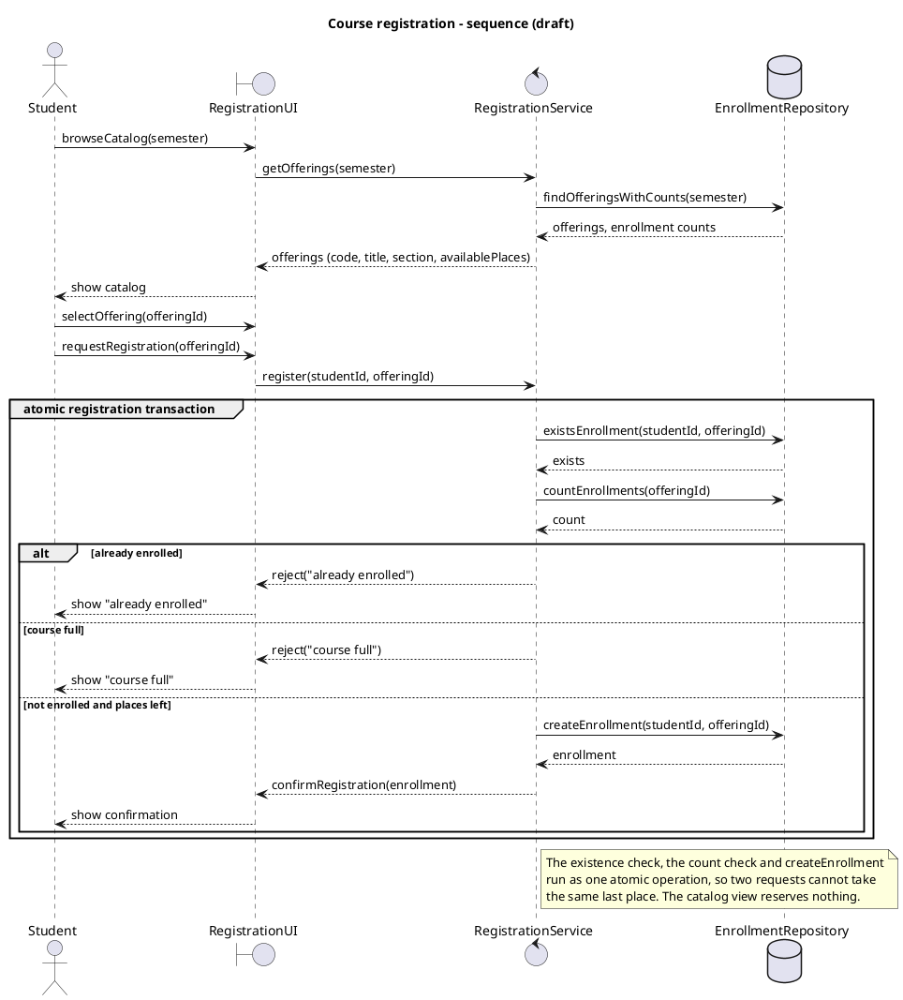
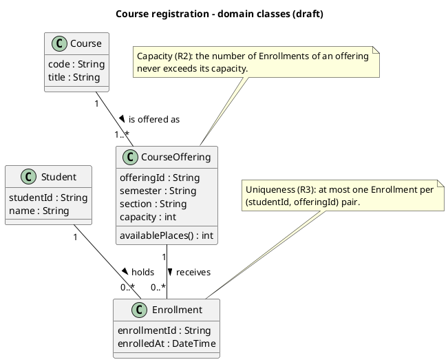

# SIS #02 — AI-Assisted UML Modeling: University Course Registration

<!--
  This is the only file you write your report in. README.md tells you what goes where.

  Rules the checker relies on:
  - Do not delete, rename or renumber the ## headings, the ### headings, or the **Label:** words.
  - Replace every "(write here)" and "(paste here)". None may be left when you submit.
  - Comments like this one are ignored by the checker and the word counter. Delete them or leave them.
-->

## 1. Scope and assumptions

<!-- Your FINAL scope statement and assumptions, after reviewing Prompt A's output. Say here
     what is out of scope (payments, prerequisites, timetable clashes, waiting lists,
     cancellation) — section 2 must not mention them. Section 10 keeps your first version. -->

**Scope:** a signed-in student browses the catalog of one semester and registers for one specific course offering; the duplicate and capacity checks and the creation of the Enrollment happen as one atomic step. Out of scope: payments, prerequisites, timetable clashes, waiting lists and cancellation.

**Assumptions:**

1. The enrollment count of an offering is the number of Enrollment records for that offering; available places = capacity minus that count, so nothing else has to be updated.
2. Two registration requests that arrive at the same time are handled one at a time inside the atomic step, so they cannot both take the last place.
3. If a request is both a duplicate and for a full offering, "already enrolled" is reported (the duplicate check comes first).
4. A catalog view and the selection of an offering reserve nothing.

## 2. User stories and acceptance criteria

<!-- Your APPROVED requirements: Prompt A's draft after your review. Keep the IDs, the three
     story headings and the bullet shape. Every criterion names the rule(s) it maps to,
     e.g. (R2, R4). Two criteria per story. Nothing out of scope.
     Format of a criterion, on one bullet:
     - **AC-03** (R2, R4): Given ..., When ..., Then ... -->

### US-01 — Browse offerings

**US-01:** As a student, I want to see the offerings of one semester with course code, title, offering and available places, so that I can choose an offering to register for.

- **AC-01** (R1): Given semester Fall 2026 has offering CS101-01 of course CS101 "Introduction to Programming" with capacity 30 and 12 enrollments, When the student opens the catalog for Fall 2026, Then the catalog lists CS101, "Introduction to Programming", CS101-01 and 18 available places.
- **AC-02** (R1, R2): Given the catalog shows 1 available place for CS101-01, When the student only views the catalog, Then no place is reserved and the enrollment count of CS101-01 stays unchanged.

### US-02 — Register for an offering

**US-02:** As a student, I want to register for a specific offering, so that I get a confirmed place in it.

- **AC-03** (R2, R4): Given CS101-01 has capacity 2 and 0 enrollments and the student is not enrolled in it, When the student requests registration for CS101-01, Then exactly one Enrollment linking the student and CS101-01 is created, the available places become 1 and a confirmation is returned.
- **AC-04** (R2, R4): Given CS101-01 has capacity 2 and 1 enrollment and the student is not enrolled in it, When the student requests registration, Then exactly one Enrollment is created, the enrollment count becomes 2, 0 places remain and a confirmation is returned.

### US-03 — Receive a clear rejection

**US-03:** As a student, I want a clear reason when my registration is rejected, so that I understand why I was not enrolled.

- **AC-05** (R2, R5): Given the catalog earlier showed a free place but CS101-01 now has 2 enrollments of capacity 2, When the student requests registration, Then the request is rejected with "course full", no Enrollment is created and the count stays 2.
- **AC-06** (R3, R5): Given the student already has an Enrollment in CS101-01, which has capacity 2 and 1 enrollment, When the same student requests registration again, Then the request is rejected with "already enrolled", no Enrollment is created and the count stays 1.

## 3. Sequence diagram

<!-- The FINAL diagram, rendered. Change .png to .svg if that is what you exported. -->


**Participants:** (write here — each lifeline and what it stands for)

**Atomic operation:** (write here — which messages form the one atomic step: the final duplicate check, the capacity check and the creation of the Enrollment, and why a catalog view reserves nothing)

**Where the Enrollment is created:** (write here — which message, which lifeline, and which class in section 4 it produces)

**Technical lifelines:** (write here — every lifeline that is NOT a class in the class diagram, by name, and why the difference in abstraction is fine. "None" if there are none.)

## 4. Class diagram

<!-- The FINAL diagram, rendered. -->


<!-- One row per association in classes.puml, read in both directions. -->

| Association | Read left to right | Read right to left |
| --- | --- | --- |
| (write here) | (write here) | (write here) |
| (write here) | (write here) | (write here) |
| (write here) | (write here) | (write here) |

**How an Enrollment links a student to an offering:** (write here)

**Capacity constraint:** (write here — and why multiplicity alone cannot express it)

**Uniqueness constraint:** (write here — and why multiplicity alone cannot express it)

## 5. Traceability

<!-- Every rule, including the catalog fields and availability (R1). Column 1: the rule and
     the criteria that cover it, e.g. "R2 + AC-03, AC-04". Column 2: the message, guard,
     class or constraint that shows the rule in YOUR diagrams. Column 3: the T-ID that
     exercises it, or the extra check you did instead (R1 has no T case). -->

| Rule and criterion | Model evidence | Validation case |
| --- | --- | --- |
| R1 + (write here) | (write here) | (write here) |
| R2 + (write here) | (write here) | (write here) |
| R3 + (write here) | (write here) | (write here) |
| R4 + (write here) | (write here) | (write here) |
| R5 + (write here) | (write here) | (write here) |

## 6. Walkthroughs

<!-- Walk each case through YOUR final sequence diagram, message by message. Column 2: the
     actual steps and the state change (count before → after). Column 3 starts with Pass or
     Fail, then the location: the message, guard or note where you saw it. A Fail you
     report honestly is a finding, not a penalty. -->

| Case | Observed path and state change | Judgment and evidence |
| --- | --- | --- |
| T1. Available | (write here) | (write here) |
| T2. Last place | (write here) | (write here) |
| T3. Full | (write here) | (write here) |
| T4. Duplicate | (write here) | (write here) |

## 7. Review decisions

<!-- At least three substantive decisions about Prompt C's critique or your own inspection.
     Decision: accepted / rejected / modified — and what you did. Reason: why, in a full
     sentence. Rule: R1–R5. Do not invent an error to fill the table; a justified rejection
     of advice counts. -->

| AI suggestion or model element | Decision | Reason | Rule |
| --- | --- | --- | --- |
| (write here) | (write here) | (write here) | (write here) |
| (write here) | (write here) | (write here) | (write here) |
| (write here) | (write here) | (write here) | (write here) |

## 8. Modeling explanation

<!-- 200–300 words. Your main design choices; how the class diagram and the sequence diagram
     complement each other; why an activity diagram could also help explain the workflow. -->

(write here)

## 9. Reflection

<!-- 150–200 words. Written by you, not by the assistant: where AI helped, one decision you
     made yourself, one remaining limitation. Specific beats flattering. -->

(write here)

## 10. Appendix A — Before AI

<!-- Written BEFORE you run Prompt A, committed and pushed in your first commit, and never
     edited afterwards. This is what you paste into Prompt A as "My initial assumptions". -->

**Scope:** a signed-in student browses one semester's catalog and registers for one course offering, with capacity and duplicate checks before the enrollment is created.

**Initial assumptions:**

1. The enrollment count of an offering is the number of Enrollment records for that offering.
2. Two registration requests that arrive at the same time are handled one at a time, so they cannot both take the last place.

## 11. Appendix B — AI exchanges

<!-- Complete prompts and complete responses, as text — never screenshots. Paste each inside
     the ~~~~ block that follows its label: AI responses contain ``` PlantUML blocks, and
     ~~~~ keeps them from breaking this file. Prompts B and C: the prompt text first, then
     the material it refers to ("below", "these two") pasted under it, in the same block.
     You may add B5, B6 … after B4 if you ran more. -->

### B1 — Requirements (Prompt A)

- **Tool:** Claude (claude.ai, Claude Code session)
- **Model:** claude-opus-5-5
- **Date:** 2026-10-18
- **Purpose:** draft 3 user stories and 6 acceptance criteria

<!-- Model: the exact model with its version, as the tool shows it (e.g. "GPT-5 Thinking",
     "Claude Sonnet 4.5"). If the tool does not show it, write: not displayed
     Date: YYYY-MM-DD -->

**Prompt:**

~~~~text
Act as a requirements analyst. Use only this course registration scenario and rules R1–R5: A student browses an electronic course catalog, chooses a course offering and requests registration. Each offering has a limited number of places. A Course describes a subject. A CourseOffering is one scheduled section in one semester. Registration always targets a specific offering. Assume that the student is signed in, the selected offering exists, and its capacity is a positive whole number. Exclude payments, prerequisites, timetable clashes, waiting lists and cancellation. Use fictional students and courses.
R1. Catalog: Show the course code, title, offering and available places for one semester.
R2. Capacity: Recheck current availability when registering. Enrollment must never exceed the offering's capacity.
R3. Duplicates: A student may have at most one enrollment in the same offering. Reject a repeat request.
R4. Success: Create exactly one Enrollment linking the student and offering, update availability and return a confirmation.
R5. Rejection: Explain "course full" or "already enrolled". Create no enrollment and leave the enrollment count unchanged.
A catalog view does not reserve a place. Model the final checks and enrollment creation as one atomic operation so competing requests cannot take the same last place.. My initial assumptions are 1. The enrollment count of an offering is the number of Enrollment records for that offering. 2. Two registration requests that arrive at the same time are handled one at a time, so they cannot both take the last place.
Draft 3 user stories and 2 Given / When / Then acceptance criteria for each. Use IDs US-01 to US-03 and AC-01 to AC-06. Map each criterion to rule IDs.
Cover normal and rejection behavior. List uncertainty separately. Do not add excluded features or invent university policies.
~~~~

**Response:**

~~~~text
User stories and acceptance criteria (fictional data: student Aru Bekova, course CS101 "Introduction to Programming", offering CS101-01 in Fall 2026)

US-01 - Browse offerings
As a student, I want to see the offerings of one semester with course code, title, offering and available places, so that I can choose an offering to register for.

- AC-01 (R1): Given semester Fall 2026 has offering CS101-01 of course CS101 "Introduction to Programming" with capacity 30 and 12 enrollments, When the student opens the catalog for Fall 2026, Then the catalog lists CS101, "Introduction to Programming", CS101-01 and 18 available places.
- AC-02 (R1, R2): Given the catalog shows 1 available place for CS101-01, When the student only views the catalog, Then no place is reserved and the enrollment count of CS101-01 stays unchanged.

US-02 - Register for an offering
As a student, I want to register for a specific offering, so that I get a confirmed place in it.

- AC-03 (R2, R3, R4): Given CS101-01 has capacity 2 and 0 enrollments and the student is not enrolled in it, When the student requests registration for CS101-01, Then exactly one Enrollment linking the student and CS101-01 is created, the available places become 1 and a confirmation is returned.
- AC-04 (R2, R4): Given CS101-01 has capacity 2 and 1 enrollment and the student is not enrolled in it, When the student requests registration, Then exactly one Enrollment is created, the enrollment count becomes 2, 0 places remain and a confirmation is returned.

US-03 - Receive a clear rejection
As a student, I want a clear reason when my registration is rejected, so that I understand why I was not enrolled.

- AC-05 (R2, R5): Given the catalog earlier showed a free place but CS101-01 now has 2 enrollments of capacity 2, When the student requests registration, Then the request is rejected with "course full", no Enrollment is created and the count stays 2.
- AC-06 (R3, R5): Given the student already has an Enrollment in CS101-01, which has capacity 2 and 1 enrollment, When the same student requests registration again, Then the request is rejected with "already enrolled", no Enrollment is created and the count stays 1.

Uncertainty (not decided by the scenario):
1. If a request is both a duplicate and for a full offering, the scenario does not say which reason is reported first.
2. Whether "available places" is stored on the offering or computed as capacity minus the enrollment count.
3. How the student chooses the semester for the catalog (fixed current semester or a selector).
4. The exact content of the confirmation (enrollment id, offering, remaining places).
~~~~

### B2 — UML drafts (Prompt B)

- **Tool:** Claude (claude.ai, Claude Code session)
- **Model:** claude-opus-5-5
- **Date:** 2026-10-18
- **Purpose:** draft the sequence and class diagrams

**Prompt:**

~~~~text
Using my approved scenario, R1–R5, stories and criteria below, return separate PlantUML code blocks for a sequence diagram and a domain class diagram.
Sequence: include catalog browsing and guarded success, full-course and duplicate outcomes. Model final checks and creation as one atomic operation.
Class: show domain concepts, useful attributes and multiplicities. State the capacity and uniqueness constraints. Explain assumptions and any technical lifelines.

A student browses an electronic course catalog, chooses a course offering and requests registration. Each offering has a limited number of places. A Course describes a subject. A CourseOffering is one scheduled section in one semester. Registration always targets a specific offering. Assume that the student is signed in, the selected offering exists, and its capacity is a positive whole number. Exclude payments, prerequisites, timetable clashes, waiting lists and cancellation. Use fictional students and courses.
R1. Catalog: Show the course code, title, offering and available places for one semester.
R2. Capacity: Recheck current availability when registering. Enrollment must never exceed the offering's capacity.
R3. Duplicates: A student may have at most one enrollment in the same offering. Reject a repeat request.
R4. Success: Create exactly one Enrollment linking the student and offering, update availability and return a confirmation.
R5. Rejection: Explain "course full" or "already enrolled". Create no enrollment and leave the enrollment count unchanged.
A catalog view does not reserve a place. Model the final checks and enrollment creation as one atomic operation so competing requests cannot take the same last place.

US-01 — Browse offerings

US-01: As a student, I want to see the offerings of one semester with course code, title, offering and available places, so that I can choose an offering to register for.

- AC-01 (R1): Given semester Fall 2026 has offering CS101-01 of course CS101 "Introduction to Programming" with capacity 30 and 12 enrollments, When the student opens the catalog for Fall 2026, Then the catalog lists CS101, "Introduction to Programming", CS101-01 and 18 available places.
- AC-02 (R1, R2): Given the catalog shows 1 available place for CS101-01, When the student only views the catalog, Then no place is reserved and the enrollment count of CS101-01 stays unchanged.

US-02 — Register for an offering

US-02: As a student, I want to register for a specific offering, so that I get a confirmed place in it.

- AC-03 (R2, R4): Given CS101-01 has capacity 2 and 0 enrollments and the student is not enrolled in it, When the student requests registration for CS101-01, Then exactly one Enrollment linking the student and CS101-01 is created, the available places become 1 and a confirmation is returned.
- AC-04 (R2, R4): Given CS101-01 has capacity 2 and 1 enrollment and the student is not enrolled in it, When the student requests registration, Then exactly one Enrollment is created, the enrollment count becomes 2, 0 places remain and a confirmation is returned.

US-03 — Receive a clear rejection

US-03: As a student, I want a clear reason when my registration is rejected, so that I understand why I was not enrolled.

- AC-05 (R2, R5): Given the catalog earlier showed a free place but CS101-01 now has 2 enrollments of capacity 2, When the student requests registration, Then the request is rejected with "course full", no Enrollment is created and the count stays 2.
- AC-06 (R3, R5): Given the student already has an Enrollment in CS101-01, which has capacity 2 and 1 enrollment, When the same student requests registration again, Then the request is rejected with "already enrolled", no Enrollment is created and the count stays 1.
~~~~

**Response:**

~~~~text
Sequence diagram:



Class diagram:



Assumptions:
1. Available places are computed as capacity minus the number of Enrollments of the offering; nothing is stored separately, so creating the Enrollment is what updates availability (R4).
2. The duplicate check is evaluated before the capacity check, so a student who is already enrolled always gets "already enrolled".
3. selectOffering only happens in the UI; it sends no message to the service and reserves no place.

Technical lifelines:
- RegistrationUI (boundary) stands for the screen the student uses; it is not a domain class.
- RegistrationService (control) coordinates the checks and the creation and owns the atomic operation.
- EnrollmentRepository (database) stands for stored Enrollments and offerings. These three are design-level helpers, so they appear in the sequence diagram but not in the domain class diagram.
~~~~

### B3 — Model critique (Prompt C)

- **Tool:** (write here)
- **Model:** (write here)
- **Date:** (write here)
- **Purpose:** review both models against R1–R5 and T1–T4

**Prompt:**

~~~~text
(paste here)
~~~~

**Response:**

~~~~text
(paste here)
~~~~

### B4 — Focused revision (Prompt D)

- **Tool:** (write here)
- **Model:** (write here)
- **Date:** (write here)
- **Purpose:** apply my accepted review decisions

**Prompt:**

~~~~text
(paste here)
~~~~

**Response:**

~~~~text
(paste here)
~~~~

## 12. Appendix C — Original diagrams

<!-- The AI's first output from Prompt B, rendered unedited from models/original/. -->


## 13. Appendix D — References and source checks

### References

<!-- Full references, one per line, each starting with "- ". Only sources you actually opened.
     Every URL used in the source checks must also appear here. Example:
     - Sommerville, I. (2016). Software Engineering, 10th ed., Global Edition. Pearson. Ch. 5. -->

- (write here)

### Source checks

<!-- At least two modeling decisions you verified. Source and locator: title + slide, page,
     section, chapter or figure — or title + URL + access date (YYYY-MM-DD). Slide numbers
     refer to the decks posted in our Teams. -->

| Modeling decision | Source and locator | What the source says | How it supports or changed your model |
| --- | --- | --- | --- |
| (write here) | (write here) | (write here) | (write here) |
| (write here) | (write here) | (write here) | (write here) |
